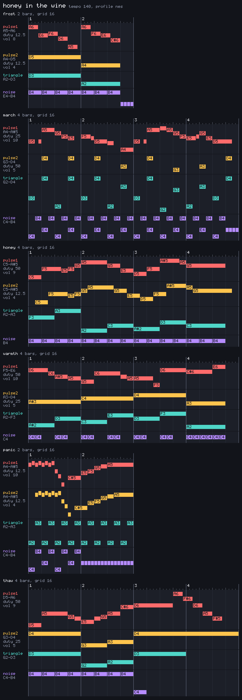

# piropipo

https://github.com/user-attachments/assets/cd035703-bcdf-441d-a8c8-626e75a98ee3

a chiptune instrument for AI agents. `piro` takes a small grid notation in and gives you 8-bit wav files out, plus enough verification that an agent can trust a sound it will never hear.

## why this exists

agents turn out to be decent little composers and terrible at classic music macro languages. in MML, a note's position is the sum of every duration before it - one wrong length early in the bar and everything after it shifts, with nothing on the page looking wrong. an agent will make exactly that mistake, confidently, every time.

so the grid has one hard rule: a note's position is always written down, never derived. `2.9: A2 x16` means bar 2, slot 9, rings 16 slots. a wrong length stays a local mistake, and the checker can verify every line on its own. the full notation is in [the format reference](skills/piropipo/references/format.md), and honestly that one line is most of it. and when you'd rather not do the counting at all, write the notes in order without positions and `piro sketch` places them - the output is ordinary `.piro`, every position written, still checkable line by line.

the other half of the trick is constraint profiles. the default `nes` card only lets through what the actual chip could play (two pulses, a triangle with no volume knob, a noise lane). that constraint is most of the chip sound - take it away and you just get square waves.

## the verbs

```
piro track song.piro     # grid in, wav out, beside the input
piro sfx coin            # a game sound from a preset; real units to tweak it
piro check song.piro     # lint + render stats, writes nothing
piro roll song.piro      # a piano-roll png (the jingle's is at the bottom)
piro sketch song.sketch  # notes in order in, positioned .piro out
```

everything answers in json on stdout, because the main user is a program. `--human` gets you sentences instead.

the deaf-composer problem is handled in layers: `check` lints positions and chip ranges before anything renders; the stats report duration, peak, a per-bar loudness curve, each lane's activity, and a harmony advisory for sustained clashes; `--events` hands every note and written rest, sample-exact, to anything you build on top; and `roll` draws the grid (`--patterns`/`--bars` crop one section) so eyes (yours, or a vision model's) can catch what numbers miss.

`piro sfx` deserves its own sentence: presets like `coin`, `jump` and `explosion` work with zero knobs, the dials are real units (Hz, ms, semitones) instead of sfxr's 0-to-1 mystery floats, and the same command gives you the same bytes every run. the flag table and preset-reshaping rules live in [sfx-mapping.md](skills/piropipo/references/sfx-mapping.md).

## getting it

prebuilt binaries for linux (x86_64, arm64), macos (arm64) and windows are on the [releases page](https://github.com/miyo-hime/piropipo/releases) - download, unpack, done. or build it yourself:

```
cargo build --release
```

one binary, `piro`. rust because the alternative was python and i'd rather not.

then hand it to the musician: grab the skill at [skills/piropipo](skills/piropipo/SKILL.md) - the craft loop, the chip idioms, how to read the check reports. installing it is your agent's problem, not mine; point yours at the directory and ask it to set itself up. the references inside are the same docs humans read, so i don't have to write the same things twice.

## status

the NES is done: the grid, the five verbs, song structure (`play` blocks with pattern order, repeats and transpose), per-pattern meter (`beats 7` makes a real 7/8), all six effects riding each other where it makes sense, a `--strict` check that refuses silence nobody wrote down, and an official jingle. the notation should be mostly stable, though i reserve the right to break it while the version starts with 0.

a profile is just a card, and the NES happens to be the first one. other chips may get their profiles when i'm not lazy.

## the jingle

piropipo has an official theme, composed on piropipo by an agent that never heard it: [docs/honey-in-the-wine.piro](docs/honey-in-the-wine.piro). it doubles as the big worked example - six patterns, a key change of heart, and every effect the format knows. render it yourself:

```
piro track docs/honey-in-the-wine.piro
```

or read it the way the composer did:

<details>
<summary>unfold the full six-pattern roll</summary>



</details>
