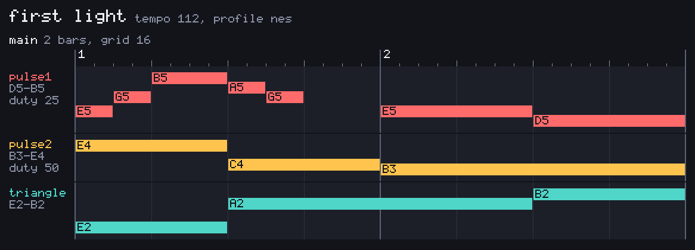

# piropipo



a chiptune instrument for AI agents. `piro` takes a small grid notation in and gives you 8-bit wav files out, plus enough verification that an agent can trust a sound it will never hear.

## why this exists

agents turn out to be decent little composers and terrible at classic music macro languages. in MML, a note's position is the sum of every duration before it - one wrong length early in the bar and everything after it shifts, with nothing on the page looking wrong. an agent will make exactly that mistake, confidently, every time.

so the grid has one hard rule: a note's position is always written down, never derived. `2.9: A2 x16` means bar 2, slot 9, rings 16 slots. a wrong length stays a local mistake, and the checker can verify every line on its own. the full notation is in [the format reference](skills/piropipo/references/format.md), and honestly that one line is most of it.

the other half of the trick is constraint profiles. the default `nes` card only lets through what the actual chip could play (two pulses, a triangle with no volume knob, a noise lane). that constraint is most of the chip sound - take it away and you just get square waves.

## the verbs

```
piro track song.piro     # grid in, wav out, beside the input
piro sfx coin            # a game sound from a preset; real units to tweak it
piro check song.piro     # lint + render stats, writes nothing
piro roll song.piro      # the piano-roll png up top
```

everything answers in json on stdout, because the main user is a program. `--human` gets you sentences instead.

the deaf-composer problem is handled in layers: `check` lints positions and chip ranges before anything renders, the stats report duration, peak and whether a lane came out silent, and `roll` draws the grid so eyes (yours, or a vision model's) can catch what numbers miss.

`piro sfx` deserves its own sentence: presets like `coin`, `jump` and `explosion` work with zero knobs, the dials are real units (Hz, ms, semitones) instead of sfxr's 0-to-1 mystery floats, and the same command gives you the same bytes every run. the flag table and preset-reshaping rules live in [sfx-mapping.md](skills/piropipo/references/sfx-mapping.md).

## getting it

prebuilt binaries for linux (x86_64, arm64), macos (arm64) and windows are on the [releases page](https://github.com/miyo-hime/piropipo/releases) - download, unpack, done. or build it yourself:

```
cargo build --release
```

one binary, `piro`. rust because the alternative was python and i'd rather not.

then hand it to the musician: grab the skill at [skills/piropipo](skills/piropipo/SKILL.md) - the craft loop, the chip idioms, how to read the check reports. installing it is your agent's problem, not mine; point yours at the directory and ask it to set itself up. the references inside are the same docs humans read, so i don't have to write the same things twice.

## status

young but whole: the grid, the four verbs, the nes profiles, song structure (`play` blocks with pattern order, repeats and transpose), and all six effects work and are tested. the notation should be mostly stable now, though i reserve the right to break it while the version starts with 0.
